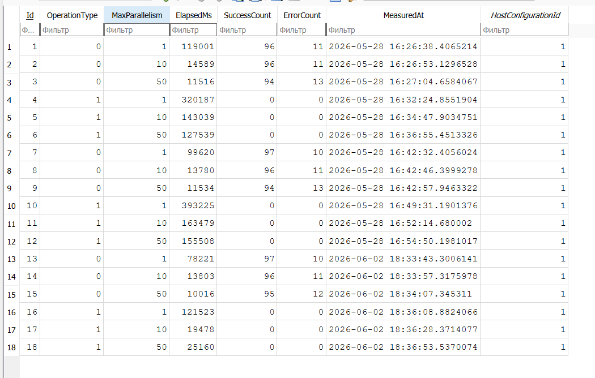

0 - Scan
1 - Download

У Scan рост параллелизма с 1 по 10 результат на лицо ускорил с 119001 ms до 14589 ms, с 10 по 50 всего лишь ускорил на 3000 ms, это незначительно, тем самым нету смысла выделять больше 10 потоков.

У Download с 1 по 10 ускорилось с 320187 ms до 143039 ms, тоже результат на лицо, с 10 по 50 тоже результат незначительный, а вот во третьем замере даже стало медленнее с 19478 ms до 25160 ms, так как при 50 потоках накладные расходы идут на переключение, конкуренцию за сеть и одновременную запись на диск перевесили выгоду от параллелизма. Для скачивания крупных файлов слишком высокий параллелизм вредит.

По поводу третьего замера. Download при одном потоке в третьем прогоне 121523 ms оказался быстрее первых двух 320187 и 393225 ms, такая же ситуация и со Scan, хотя код не менялся. Возможно связано из-за внешних факторов, таких как более свободной сети в момент запуска.

В общем 10 потоков это самое оптимальное число для сканирования и скачки, т.к. результат особо не меняется, а в некоторых случаях даже медленнее будет.