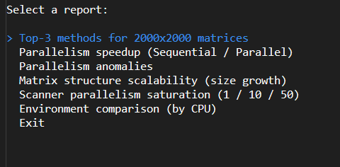
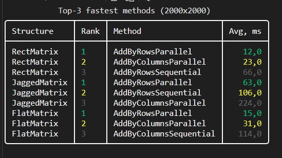
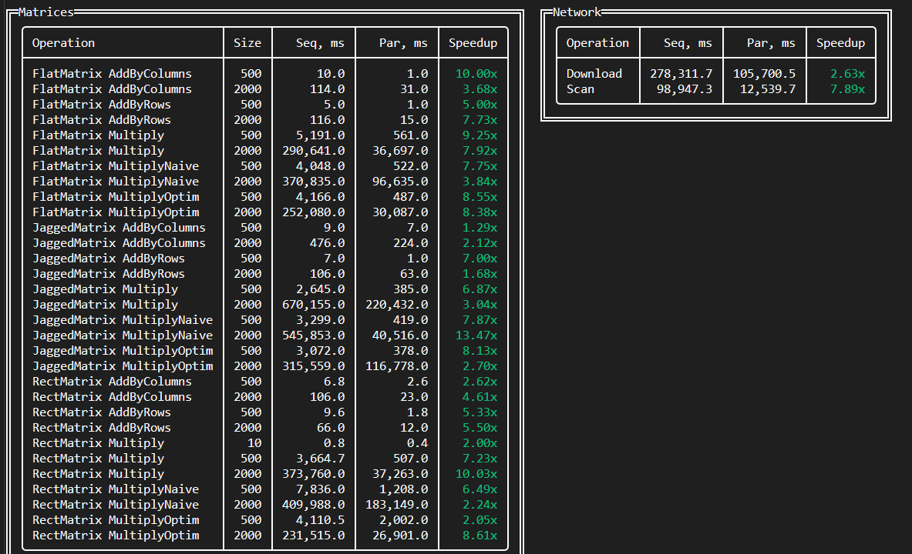
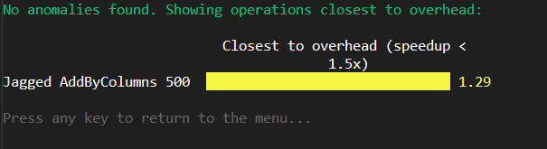
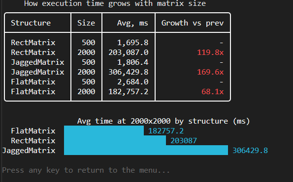
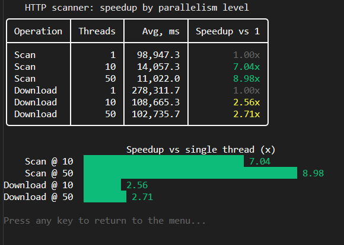
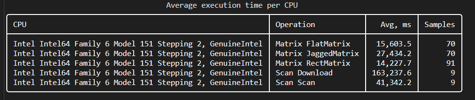
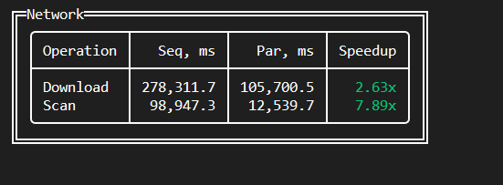

**Лабораторная работа No.5: Анализ данных и визуализация (LINQ to SQLite)**

Ветка: stage-5

**1. Примеры сложных LINQ-запросов**

*1.1. Топ-3 методов для матриц 2000×2000**

Двойная группировка: сначала по паре (структура, метод) для усреднения по повторным прогонам, затем по структуре, чтобы внутри каждой взять три самых быстрых метода и присвоить ранг.

```csharp
return data.MatrixSamples
    .Where(s => s.MatrixSize == 2000)
    .GroupBy(s => new { s.MatrixType, s.Method })
    .Select(g => new
    {
        g.Key.MatrixType,
        g.Key.Method,
        AvgMs = g.Average(s => s.ElapsedMs),
    })
    .GroupBy(x => x.MatrixType)
    .SelectMany(typeGroup => typeGroup
        .OrderBy(x => x.AvgMs)
        .Take(3)
        .Select((x, index) => new TopMethodRow(
            x.MatrixType.ToString(),
            x.Method.ToString(),
            x.AvgMs,
            index + 1)))
    .ToList();
```

**1.2. Коэффициент ускорения (Tпослед / Tпарал)**

Группируем по (хост, структура, размер, базовая операция), внутри группы раздельно усредняем последовательные и параллельные замеры, делим. Группировка по `HostConfigurationId` обязательна: иначе последовательное время с одного ПК делилось бы на параллельное с другого. `DefaultIfEmpty().Average()` страхует от групп с одним видом замеров, а `Where(Seq > 0 && Par > 0)` отсекает неполные пары.

```csharp
var matrixRows = data.MatrixSamples
    .GroupBy(s => new
    {
        s.HostConfigurationId,
        s.MatrixType,
        s.MatrixSize,
        BaseOp = MethodNaming.BaseOperation(s.Method),
    })
    .Select(g => new
    {
        g.Key,
        Seq = g.Where(s => !MethodNaming.IsParallel(s.Method))
               .Select(s => (double)s.ElapsedMs)
               .DefaultIfEmpty()
               .Average(),
        Par = g.Where(s => MethodNaming.IsParallel(s.Method))
               .Select(s => (double)s.ElapsedMs)
               .DefaultIfEmpty()
               .Average(),
    })
    .Where(x => x.Seq > 0 && x.Par > 0)
    .Select(x => new SpeedupRow(
        "Matrix",
        $"{x.Key.MatrixType} {x.Key.BaseOp}",
        x.Key.MatrixSize,
        x.Seq,
        x.Par,
        x.Seq / x.Par));
```

**1.3. Масштабируемость структур**

Коэффициент роста времени относительно предыдущего размера. Берутся только последовательные замеры, чтобы мерить чистую масштабируемость структуры памяти без шума параллелизма.

```csharp
return data.MatrixSamples
    .Where(s => !MethodNaming.IsParallel(s.Method) && s.MatrixSize >= 500)
    .GroupBy(s => new { s.MatrixType, s.MatrixSize })
    .Select(g => new
    {
        g.Key.MatrixType,
        g.Key.MatrixSize,
        AvgMs = g.Average(s => s.ElapsedMs),
    })
    .GroupBy(x => x.MatrixType)
    .SelectMany(typeGroup =>
    {
        var ordered = typeGroup.OrderBy(x => x.MatrixSize).ToList();
        return ordered.Select((x, i) => new ScalabilityRow(
            x.MatrixType.ToString(),
            x.MatrixSize,
            x.AvgMs,
            i == 0 ? 1.0 : x.AvgMs / ordered[i - 1].AvgMs));
    })
    .ToList();
```

**1.4. Насыщение по уровню параллелизма (сканер)**

Для каждой сетевой операции вычисляем ускорение относительно одиночного потока. Эталонное время (параллелизм 1) выносится в словарь, затем сопоставляется каждому уровню.

```csharp
var serialByOperation = grouped
    .Where(x => x.MaxParallelism == 1)
    .ToDictionary(x => x.OperationType, x => x.AvgMs);

return grouped
    .GroupBy(x => x.OperationType)
    .SelectMany(opGroup => opGroup
        .OrderBy(x => x.MaxParallelism)
        .Select(x => new ParallelismRow(
            x.OperationType.ToString(),
            x.MaxParallelism,
            x.AvgMs,
            serialByOperation.TryGetValue(x.OperationType, out var serial) && x.AvgMs > 0
                ? serial / x.AvgMs
                : 1.0)))
    .ToList();
```

**2. Скриншоты сгенерированных отчётов**

Меню:



Топ 3 быстрых методов для матрицы 2000x2000



Ускорение - две панели Матрицы/Сеть



Аномалии / ближайшие к оверхеду



Масштабируемость структур



Насыщение по параллелизму сканера



Сравнение окружений



**3. Выводы на основе данных**

Оптимальная структура памяти

**Замеры на матрицах 2000×2000 (последовательные методы):**


Оптимальная структура у Flat (одномерный массив). Она самая быстрая на больших размерах и лучше всех масштабируется (наименьший коэффициент роста). Причина - локальность кэша: элементы лежат в памяти подряд, процессор эффективно предзагружает данные. Jagged (массив массивов) проигрывает сильнее всех: каждая строка — отдельный объект в куче, строки разбросаны по памяти, отсюда частые промахи кэша, и эффект усиливается с ростом размера.

**Оптимальный уровень параллелизма**



Оптимальный уровень параллелизма - около 10 потоков. Переход с 1 на 10 потоков даёт основной выигрыш, а с 10 на 50 - почти ничего (для Download прирост символический, +0.15x). Дальнейшее наращивание упирается в потолок: пропускную способность сети и операции записи на диск. Для матричных операций параллелизм эффективен на всех структурах и размерах - случаев, где параллельная версия медленнее последовательной (ускорение < 1), не выявлено.
